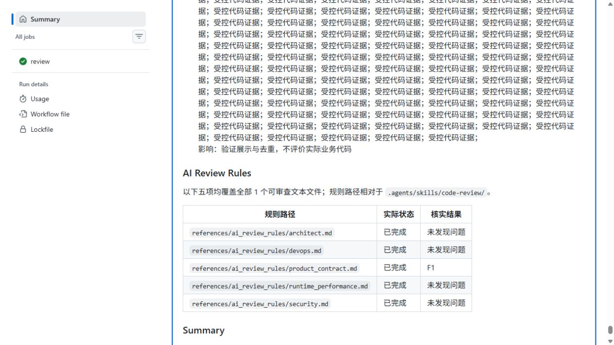
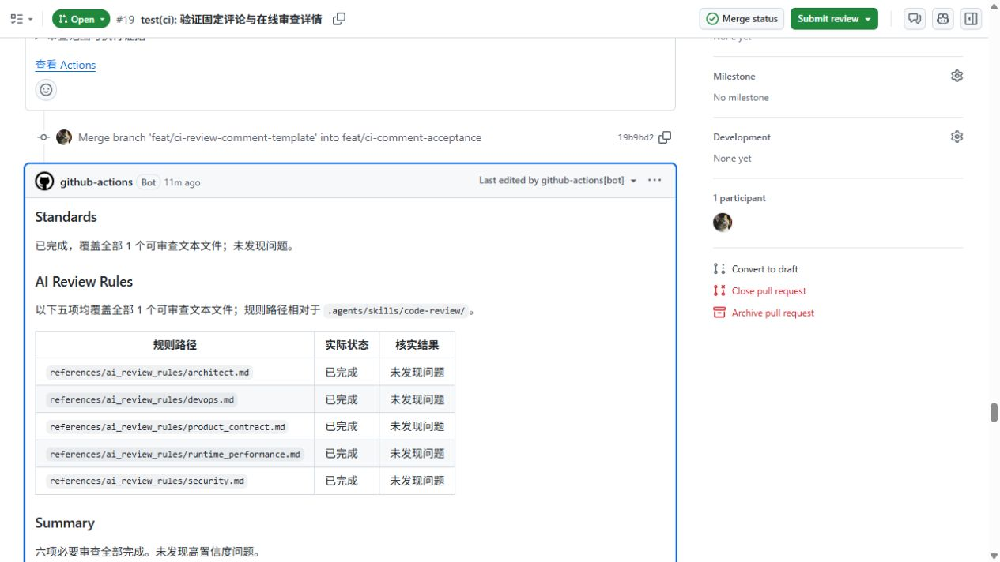

# CI 审查评论模板验收记录

日期：2026-11-12（Asia/Shanghai）。实现 PR：[#18](https://github.com/lu-keer/nuxt_huasu_review/pull/18)；验收 PR：[#19](https://github.com/lu-keer/nuxt_huasu_review/pull/19)。

## 版本与范围

- 实现代码 base：`15c3aa3fd4ae48f08b3d4878465c99dbbf80815a`。
- 验收 head：`65e4609fb22aad7850b8c3e7b2d9ffadf56e9730`。
- #19 相对实现分支仅增加普通代码常量，触发真实六路模型审查；该验收代码不合入产品分支。
- 独立受控 workflow 使用 base 的可信模块演示展示场景；评论均明确标注“非模型审查，状态与问题均为测试数据”。受控数据不能作为真实业务问题或六路执行证据。
- #18 保持草稿，未合入 main；#19 验收完成后已关闭，未合并。以下结果证明实现分支链路，不代表默认分支已经上线，也不代表已完成合入后的普通 PR 回归。

## 本地验证

- `node --test .agents/skills/code-review/scripts/ci-*.test.mjs` — 通过，63 项。
- `actionlint -shellcheck=` — 通过，actionlint 1.7.12。
- `git diff --check` — 通过。

覆盖来源引用与去重、未知统计、失败/超时/取消/终态缺失、调度 FAIL/UNVERIFIED、无文本、固定提交位置及删除行、特殊字符转义、超长索引、摘要多段拆分和容量失败、写入失败、API 定位失败，以及旧 head/run/attempt 发布保护。

## 真实模型审查

最终运行：[43155489081](https://github.com/lu-keer/nuxt_huasu_review/actions/runs/43155489081)。execute、review、comment 均成功。已下载最终机器结果与执行证据核对：

- result.version=2，status=complete，reasons=[]。
- 六路均 completed，modelConfirmed=true，各有一条完整材料读取记录；严格调度 PASS，有效 worker 容量 6，实际最大并发 2。
- Critical/Major/Minor 均为 0；剔除、合并均为 0。
- 交付目录仅 result.json、delivery.json；没有 report.md，delivery.required=false、parts=0、confirmed=true，无重复 Job Summary。
- [正式评论](https://github.com/lu-keer/nuxt_huasu_review/pull/19#issuecomment-6814514042) 保持原 comment ID 更新；隐藏标记为最终 head/run/attempt，仅存在一条正式标记评论，受控评论未被误识别。
- 浏览器已确认最终正文从 Standards 开始，五条规则三列表格和 Summary 正常显示，底部仅有 Actions 链接。

前两轮普通代码审查运行 [43154454435](https://github.com/lu-keer/nuxt_huasu_review/actions/runs/43154454435) 与 [43154865391](https://github.com/lu-keer/nuxt_huasu_review/actions/runs/43154865391) 均成功；它们是较早版本证据，不代替最终版本验收。运行 43155244861 被后续同步取消，不列为通过。

## 受控展示与在线文档

最终受控运行：[43155489067](https://github.com/lu-keer/nuxt_huasu_review/actions/runs/43155489067)，成功。已下载该轮机器数据和评论原文进行核对。

| 场景 | 评论 | 实际交付 |
|---|---|---|
| 完成无问题 | [no-findings](https://github.com/lu-keer/nuxt_huasu_review/pull/19#issuecomment-6814609324) | 三段正文、固定五行；无独立摘要 |
| 完成有问题 | [findings](https://github.com/lu-keer/nuxt_huasu_review/pull/19#issuecomment-6814609499) | 1 Minor、两条来源、详情一次、合并 1 项；无独立摘要 |
| 部分未完成 | [incomplete](https://github.com/lu-keer/nuxt_huasu_review/pull/19#issuecomment-6814609645) | security 超时、整体未完成，保留 1 Minor |
| 无可审查文本 | [no-text](https://github.com/lu-keer/nuxt_huasu_review/pull/19#issuecomment-6814609784) | 五路未运行、调度不适用；无独立摘要 |
| 超长详情 | [long](https://github.com/lu-keer/nuxt_huasu_review/pull/19#issuecomment-6814610024) | 评论 1,507 字符（含受控标签），完整详情 631,794 字节，1 个 Job Summary 分片 |

[最终在线审查文档](https://github.com/lu-keer/nuxt_huasu_review/actions/runs/43155489067#summary-130974336125) 已在浏览器直接打开，核实 Standards、AI Review Rules、Summary 正文及表格存在，无需下载。

浏览器验收发现 API 返回的 job URL 默认打开日志，已修正为从真实 job ID 生成运行总览的 `#summary-{jobId}` 链接。早期运行的旧日志入口不作为最终在线阅读验收结果。

## 展示截图

以下截图分别来自最终真实运行的正式评论和最终受控运行的在线摘要；不将受控问题描述为模型发现。

## 限制与上线条件

- 真正由模型发现业务问题、真正模型超时及真正调度失败未在本轮主动制造；这些展示由受控数据和本地契约测试覆盖，不能描述为真实模型故障验收。
- 云端超长样例为 1 分片；多分片重组、单段超限、总量超限及磁盘写入失败由本地测试覆盖，未声明为云端故障注入结果。
- Job Summary 继承 Actions 的访问权限和运行保留策略，不是永久文档；原始证据 artifact 保留 7 天，不作为在线文档入口。
- 上线需合入 #18；随后以 main 为 base 的普通 PR 仍需复验。历史严格调度验收记录不作改写。
